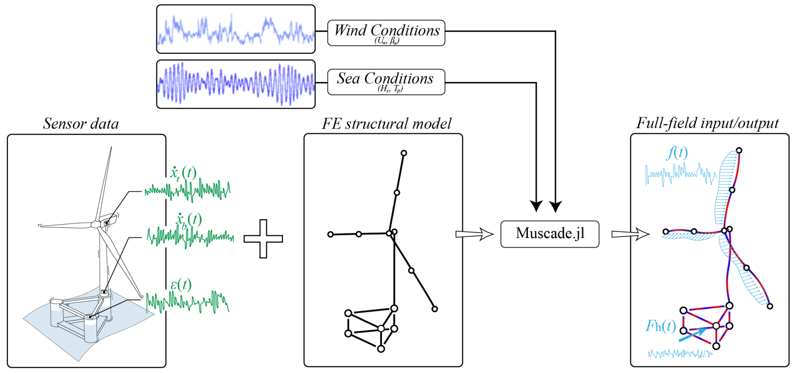

# Muscade.jl

**Create and solve FEM-constrained optimisation models.**


## What are FEM-constrained optimisation problems

FEM-constrained optimisation problems are optimisation problems that apply equilibrium equations obtained from a finite element method (FEM) as constraints.  Such problems appear in a variety of  industrial and academic applications. 
- In *mechanical design optimisation*, the design of a structure represented by a FE model is adjusted to withstand some specified loads with minimal material usage. 
- *Load estimation* identifies unknown external loads that cause the FE model of a system to respond in a way that reflects available measurements, see figure below . 
- In *model calibration*, load estimation is combined with adjustments to the FE model itself (e.g structural properties) to reflect available measurements. 
- In cybernetics, *state estimation* seeks to estimate the internal state of a system, based on past measurements and partial knowledge of external excitation, while *optimal control* seeks moderate actuator loads leading the dynamical system into a desired state. 
- *Sensor array optimisation* determines the optimal placement of sensors in a system in order to monitor a given behaviour. 
- Finally *structural reliability* seeks the combination of loads and structural response which are the most likely to cause the failure of a structure.



## Purpose

Muscade.jl aims to be a general platform for the solution of FEM-constrained optimisation problems, using differentiable FEM, and implementing algorithms adapted from optimal control. It uses Lagrange multipliers to handle a large number of constraints. 

Muscade is not specific to a given branch of physics or engineering.  Instead, it provides a generic platform for the development of application-specific sets of elements, with a well-defined API for the element-developers. 

To improve the productivity of applications' development, Muscade uses automatic differentiation, and metaprogramming to facilitate the extraction of ``measurements'' from inside the element code. The package offers the possibility to use a graphical interface to represent models and solutions, while enabling powerful scripting of analyses. 

Solving FEM-constrained optimisation problems consists in optimising an objective function under the constraint that a FEM model be exactly verified. This in turn implies that the problem has more unknowns than the model has equation (or at least: more unknowns than linearly independent equations, as would be the case with “insufficient” boundary conditions).

The unknowns that are dual to the FEM equations are noted X-dofs (the *response* of the model). The rest of the unknowns can be separated into U-dofs (varying with time, generaly *unknown loads*) and A-dofs (constant over time, generaly *unknown model parameters*). The conditions for such a constrained optimisation problem to be well-posed are the Babushka-Brezzi conditions, which say, in essence “if you do not restrain, then at least measure”.

## Official documentation

See the [documentation](https://sintef.github.io/Muscade.jl/stable/index.html).

## Installing the latest release of Muscade.jl

In the REPL, type `]` (to go into package management mode), followed by 

- `add Muscade`.
- Press the `backspace` key to leave the package manager.

## Using the newest features of Muscade.jl

Some newer features, which have the vocation to be part of the next release, are generally pushed to the [dev branch](https://github.com/SINTEF/Muscade.jl/tree/dev). Pull that branch from the project repository, and in package mode, type `dev /pathToLocalCopyOf/Muscade.jl`. The dev branch also has its online [documentation](https://sintef.github.io/Muscade.jl/dev/).

## Citation

If you use this package in published work, please cite (review on-going):

> P. Maincon and T. Sauder, "Muscade.jl : a Julia package for 
> FEM-constrained optimisation", (2026). 
> https://doi.org/10.1016/j.softx.2026.103186

```bibtex
@article{MainconSauder2026,
  author  = {Maincon, P. and Sauder, T.},
  title   = {Muscade.jl : a Julia package for FEM-constrained optimisation},
  journal = {SoftwareX},
  year    = {2026},
  doi     = {10.1016/j.softx.2026.103186},
  url     = {https://doi.org/10.1016/j.softx.2026.103186},
}
```

Machine-readable metadata is in [`CITATION.cff`](CITATION.cff).